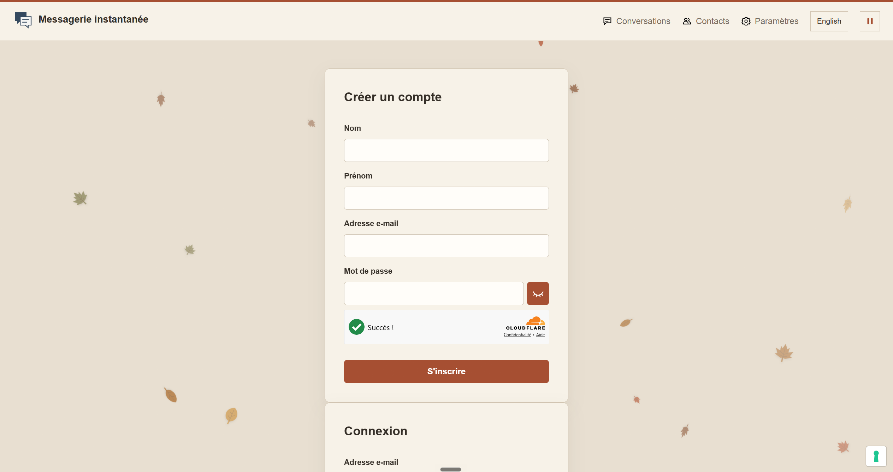

# Projet fil rouge


Nous développons cette messagerie en binôme dans le cadre d’un projet scolaire. Nous avons voulu créer un espace pour discuter, partager des GIF et utiliser quelques commandes directement dans les conversations. Nous y avons aussi ajouté des surprises pour rendre le projet un peu plus amusant.

**[Voir le site](https://kryptoward.github.io/projet-fil-rouge/)**

## Aperçu



## Ce que propose la messagerie

### Comptes et connexion

- Création d’un compte et connexion avec une adresse mail et un mot de passe.
- Vérification des champs avec les messages de confirmation et d’erreur affichés dans le formulaire.
- Bouton pour afficher ou masquer le mot de passe, avec une petite animation de l’icône.
- Protection des formulaires avec Cloudflare Turnstile.
- Récupération du mot de passe par mail et choix d’un nouveau mot de passe.
- Déconnexion depuis les paramètres.

### Conversations et contacts

- Canal général et création de canaux avec un nom et une description facultative.
- Recherche d’un canal dans la liste et affichage adapté aux petits écrans.
- Messages enregistrés avec le nom de l’auteur et la date.
- Réception des messages en temps réel avec Supabase Realtime. Une actualisation de secours prend le relais si nécessaire.
- Chargement des anciens messages et conservation du brouillon quand on change de canal sur la page.
- Modification de ses messages texte avec la mention « modifié » et suppression de ses propres messages.
- Suppression des canaux créés par son compte, à l’exception du canal général.
- Recherche d’un utilisateur par son nom affiché et envoi d’une invitation.
- Affichage des invitations envoyées, des invitations reçues et des contacts acceptés.
- Acceptation des invitations et bouton pour lancer une discussion avec un contact. La partie configuration précise ce qui reste à ajouter pour ces discussions.

Pour écrire, **Entrée** envoie le message et **Maj + Entrée** ajoute un retour à la ligne.

### GIF, météo et photos de chats

- Recherche de GIF sur KLIPY, aperçu des résultats et choix du GIF à envoyer. Un bouton permet de charger plus de résultats.
- Recherche de villes avec Open-Meteo et choix d’une ville par défaut dans les paramètres. Ce choix est enregistré dans le navigateur.
- Partage d’une carte météo avec la ville, la température, le ressenti, les conditions et le vent. La carte conserve les données du moment de l’envoi.
- Envoi d’une photo de chat aléatoire avec CATAAS. L’adresse de la photo est enregistrée pour que les participants voient la même image.
- Boutons dans la barre d’écriture pour accéder à ces fonctions sans taper de commande.

Les recherches de GIF passent par la fonction Supabase `klipy-search`. La clé KLIPY reste côté serveur et la recherche demande une session connectée.

### Interface et petites surprises

- Interface principale en français et en anglais, avec mémorisation de la langue choisie.
- Thème automnal avec des feuilles animées et un bouton pour mettre l’animation en pause.
- Réduction de certains effets si cette préférence est activée sur l’appareil.
- Fausse vérification « A2F » avant l’inscription ou la connexion. Le code est affiché dans la fenêtre. C’est une surprise ajoutée au projet, pas une vraie authentification à deux facteurs.
- Jeu de déconnexion avec plusieurs confirmations et un bouton « Oui » qui se déplace. Le bouton « Se déconnecter directement » ouvre un défi sur une carte du monde. Il faut retrouver le pays demandé pour terminer la déconnexion.
- Pages À propos, Nous contacter et Mentions légales, avec les conditions d’utilisation et les informations sur la confidentialité.
- Gestion des préférences de cookies avec iubenda.
- Formulaire pour nous contacter avec un nom, une adresse mail, un sujet et un message.

## Les commandes

Il suffit de les écrire dans la zone de message d’une conversation.

| Commande | Résultat |
| --- | --- |
| `/meteo` | Envoie la météo de la ville choisie dans les paramètres. |
| `/meteo Montréal` | Recherche la ville indiquée et partage sa météo. |
| `/gif` | Ouvre la recherche de GIF. |
| `/gif bonjour` | Lance une recherche avec le mot indiqué. |
| `/cat` | Envoie une photo de chat aléatoire. |

## Arborescence

```text
projet-fil-rouge/
├── docs/
│   └── images/
│       └── accueil.jpg
├── src/
│   ├── assets/
│   │   ├── maps/
│   │   │   ├── world-countries.json    Carte du défi de déconnexion
│   │   │   └── ATTRIBUTION.md          Source des données de la carte
│   │   └── svg/                       Icônes et illustrations
│   ├── css/
│   │   ├── styles.css                 Style commun aux pages
│   │   └── conversations.css          Style de la messagerie
│   └── js/
│       ├── app.js                     Comptes et traductions
│       ├── chat-api.js                Appels Supabase pour les messages
│       ├── conversations.js           Canaux et affichage des messages
│       ├── contact.js                 Contacts et invitations
│       ├── contact-support.js         Formulaire de contact du site
│       ├── gifs.js                    Recherche et envoi de GIF
│       ├── weather.js                 Météo et commandes
│       ├── cats.js                    Photos de chats
│       ├── captcha.js                 Widget Turnstile
│       ├── cookies.js                 Affichage du panneau de cookies
│       ├── automn.js                  Animation des feuilles
│       ├── auth-prank.js              Surprise à la connexion
│       └── logout-game.js             Jeu de déconnexion
├── supabase/
│   ├── functions/
│   │   └── klipy-search/
│   │       └── index.ts               Recherche KLIPY côté serveur
│   └── migrations/
│       ├── 202610220001_chat.sql
│       ├── 202610220002_gifs.sql
│       ├── 202610220003_message_actions.sql
│       └── 202610220004_contact.sql
├── index.html                         Inscription et connexion
├── conversations.html                 Messagerie
├── contact.html                       Contacts
├── settings.html                      Paramètres
├── pwdforgotten.html                  Récupération du mot de passe
├── a-propos.html                      Présentation du projet
├── nous-contacter.html                Formulaire de contact
├── mentions-legales.html              Informations légales
├── trad.md
├── .gitignore
└── README.md
```

## Essayer le projet en local

Le site est développé en HTML, CSS et JavaScript. Il n’y a pas d’étape de compilation. On peut ouvrir le dossier dans VS Code puis lancer `index.html` avec **Live Server**. Un serveur HTTP local est nécessaire pour charger correctement les ressources.

Une connexion Internet reste nécessaire pour Supabase et les services utilisés par les GIF, la météo, les photos de chats, Turnstile et le formulaire de contact.

## Configuration

Les pages sont hébergées sur GitHub Pages. Supabase gère les comptes, la base PostgreSQL et les messages en temps réel. Le formulaire de contact utilise un service séparé pour envoyer les mails.

Pour utiliser le projet avec sa propre configuration Supabase, voici les étapes à suivre.

1. Renseigner l’URL du projet et sa clé publique dans `src/js/app.js`.
2. Appliquer les fichiers SQL de `supabase/migrations/` dans l’ordre de leur nom. Ils créent les tables et les règles d’accès, puis activent Realtime pour les tables concernées.
3. Configurer les mails de Supabase Auth et les adresses de redirection vers `pwdforgotten.html`, pour le site et pour les essais en local.
4. Configurer Turnstile dans Supabase Auth et adapter la clé publique dans `src/js/captcha.js` aux domaines utilisés.
5. Ajouter `KLIPY_API_KEY` dans **Edge Functions → Secrets**, puis déployer la fonction `klipy-search` avec le fichier `supabase/functions/klipy-search/index.ts`.

La clé publique Supabase peut être utilisée dans le navigateur. Les droits sur les données sont définis par les règles RLS de la base. La clé KLIPY et les clés serveur Supabase doivent rester privées et ne doivent pas être ajoutées au dépôt.

### Discussions entre contacts

L’interface utilise le champ `recipient_id` pour les discussions entre contacts. Ce champ et les règles d’accès spécifiques à ces discussions ne sont pas encore présents dans les migrations du dépôt. Il faut donc compléter la base et les règles RLS avant de proposer des discussions privées sur une nouvelle installation. Les canaux partagés restent visibles par les utilisateurs connectés.

### Services externes

Le formulaire **Nous contacter*- envoie les demandes à `https://mail.a49.fr/api/contact`. Ce service est hébergé séparément, car GitHub Pages ne peut pas envoyer les mails. Pour réutiliser le projet, il faut adapter cette adresse dans `src/js/contact-support.js` ainsi que les coordonnées affichées dans les pages.

Open-Meteo et CATAAS sont utilisés sans clé dans cette version. Les crédits des services sont affichés dans l’interface. Les fonctions qui en dépendent peuvent être indisponibles si le service ne répond pas.

## La suite du projet

Nous envisageons d’ajouter la lecture vocale, la traduction des messages, des sondages et des rappels. Ces fonctions ne sont pas encore intégrées. Pour le moment, le changement de langue concerne uniquement l’interface et ne traduit pas les messages.

Le projet continue d’évoluer selon le temps disponible et les objectifs validés avec le professeur.
